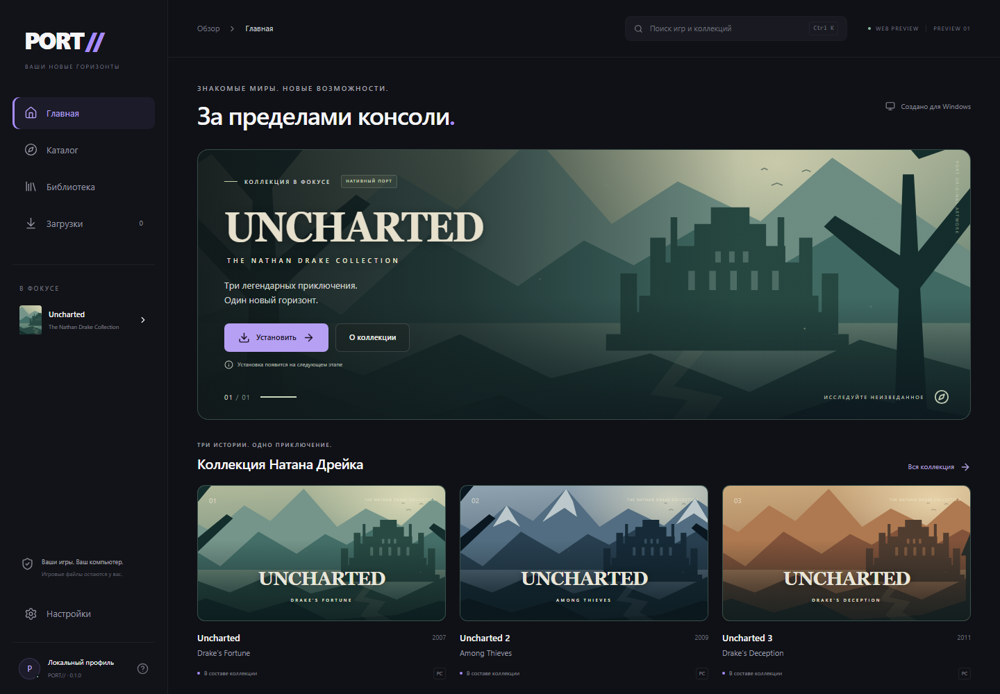

# PORT//

**Знакомые миры. Новый дом.** Независимый Windows-лаунчер нативных консольных портов.

Tauri 2 · React · TypeScript · Rust · SQLite



## Текущий статус

Stage 00–01: настоящее Windows-приложение с завершённым UI-прототипом. Работают главная, каталог, страница Uncharted, библиотека, загрузки и настройки. Установка PKG, скачивание портов и запуск игр **ещё не реализованы**. Кнопка установки честно открывает план будущей функции. Очередь и библиотека пусты; демонстрационная загрузка явно обозначена макетом.

Настройки темы, анимаций, компактности карточек и будущей папки установки сохраняются локально в SQLite. Нативный выбор папки не устанавливает игру. Приложению не нужна сеть для просмотра каталога и изменения настроек; нет учётных записей и телеметрии.

## Запуск на Windows

Нужны Node.js 24 LTS, Rust stable с MSVC toolchain, Visual Studio C++ Build Tools / Windows SDK и Microsoft Edge WebView2. См. [официальные требования Tauri](https://v2.tauri.app/start/prerequisites/). Версии зависимостей закреплены lock-файлами.

```powershell
npm ci
npm run tauri dev
```

Сборка исполняемого приложения без установщика:

```powershell
npm run tauri build -- --no-bundle
.\src-tauri\target\release\port-launcher.exe
```

`npm run tauri build` дополнительно собирает NSIS-установщик. Локальные сборки пока не подписаны. `npm run dev` — только браузерный frontend-preview, помеченный WEB PREVIEW; он использует localStorage и не заменяет Tauri.

## Проверки

```powershell
npm run build
npm run format:check
npx playwright install chromium
npm test
cargo fmt --manifest-path src-tauri/Cargo.toml -- --check
cargo test --locked --manifest-path src-tauri/Cargo.toml
cargo clippy --locked --manifest-path src-tauri/Cargo.toml -- -D warnings
```

Playwright проверяет навигацию, поиск/фильтры, диалоги, пустые состояния, offline, сохранение и сброс настроек, темы и размеры. Это frontend-тесты; проверка настоящего окна описывается отдельно в [PROGRESS.md](PROGRESS.md). [Скриншоты](screenshots/INDEX.md) разделены на браузерные и нативные.

## Архитектура

React UI → Settings Service → Tauri IPC → Rust → SQLite. Каталог пока локальный. Контракты Catalog Service, Installer Core и Game Adapters подготовлены отдельно; установщик не подключён. Три части Uncharted моделируются как карточки одной коллекции с общими данными/runtime. Неподтверждённых аргументов запуска нет.

```text
src/             UI, сервис настроек, доменные контракты
src-tauri/       нативное окно, SQLite, команды Rust
tests/           Playwright
screenshots/     визуальные результаты
docs/            архитектура, дизайн, исследование, страница Pages
```

Подробнее: [архитектура](docs/ARCHITECTURE.md), [дизайн](docs/DESIGN.md), [roadmap](ROADMAP.md), [contributing](CONTRIBUTING.md). Каждая новая сессия Codex сначала читает [AGENTS.md](AGENTS.md) и [PROGRESS.md](PROGRESS.md).

## Uncharted и авторы портов

Первая запланированная интеграция — [Uncharted PC от SuperMedo / Mohammed Albarghouthi](https://github.com/Supermedo/uncharted_pc). [Сборки автора](https://github.com/Supermedo/uncharted_pc/releases). Мы не создаём собственный порт и не выдаём его за нашу работу.

По документации автора нужен собственный **расшифрованный дамп коллекции**. Поддержка произвольных официальных PS4 PKG не заявлена. Игровые файлы, сборки порта и код GPL в PORT не включены. Требования и ограничения зафиксированы в [исследовании upstream](docs/UPSTREAM.md); их необходимо проверить заново перед Stage 02.

## Roadmap

- **00 Foundation / 01 UI Prototype** — текущая область работ.
- **02 Installer** — только по отдельному поручению: совместимые форматы, локальная проверка и безопасная установка.
- **03 Library / Runtime** — проверенный запуск, обслуживание и удаление.
- **04 Distribution** — подпись, обновления, полная release-проверка.

GitHub Actions проверяет Windows-сборку; ручной workflow Pages публикует основу страницы из docs/site после настройки Pages на GitHub Actions в репозитории. Публикация страницы не выполняется автоматически.

## Лицензии и acknowledgements

Собственный код PORT — [MIT](LICENSE). [THIRD_PARTY_NOTICES.md](THIRD_PARTY_NOTICES.md) и inventories содержат сведения о зависимостях. Перед публичным распространением бинарников нужно собрать полные тексты их лицензий. Благодарим Tauri, React, Radix, Tailwind, Motion, Lucide, rusqlite/SQLite и Playwright.

Пейзажи и значок — собственные векторные демонстрационные материалы PORT; официальные обложки и игровые логотипы не используются. Названия игр принадлежат правообладателям. PORT не связан с Sony Interactive Entertainment, Naughty Dog или Bluepoint Games.
