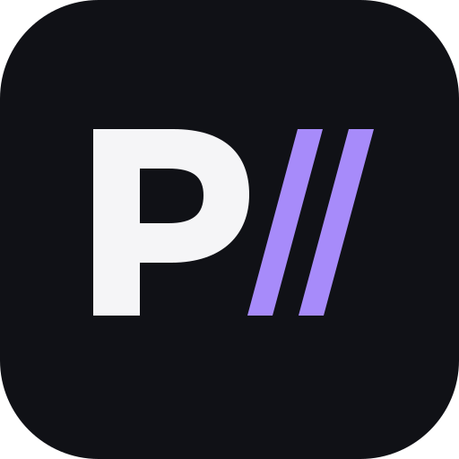
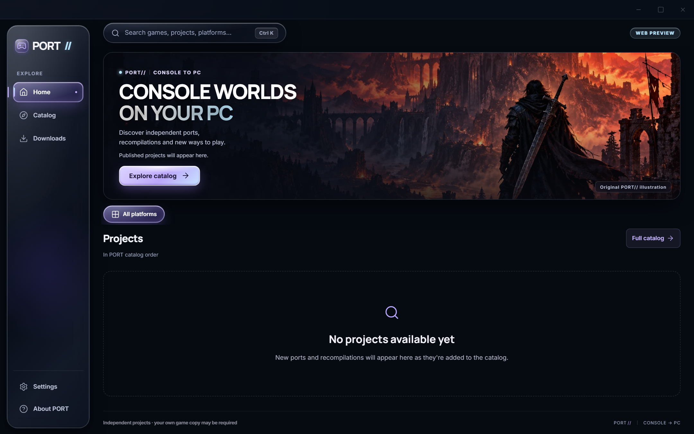
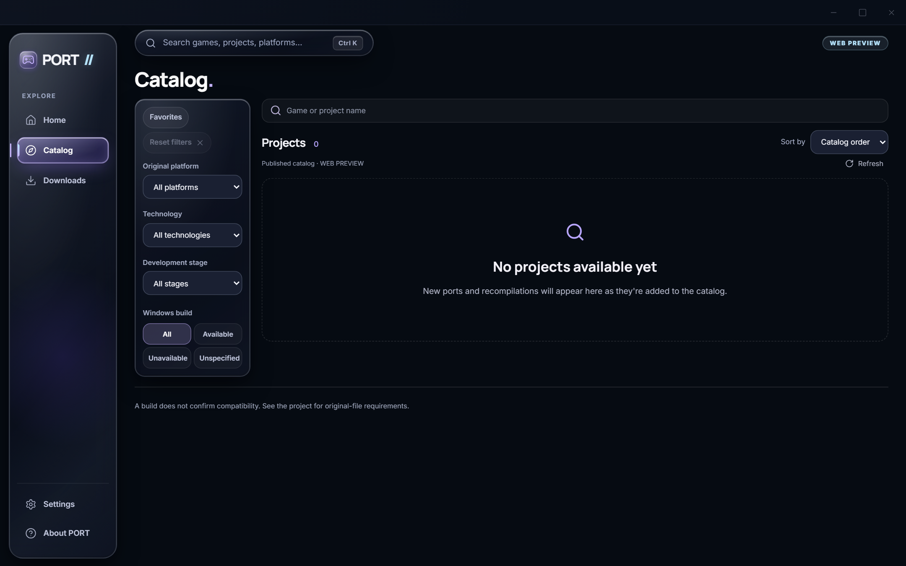
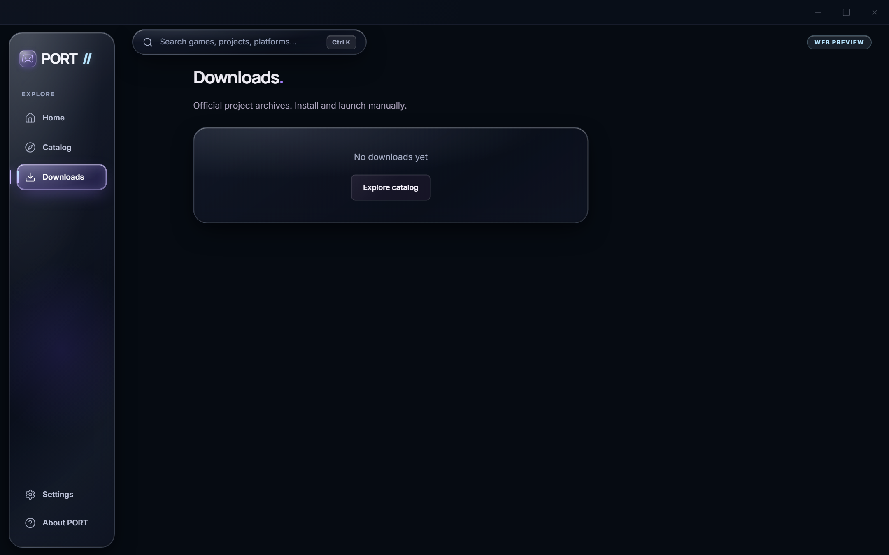
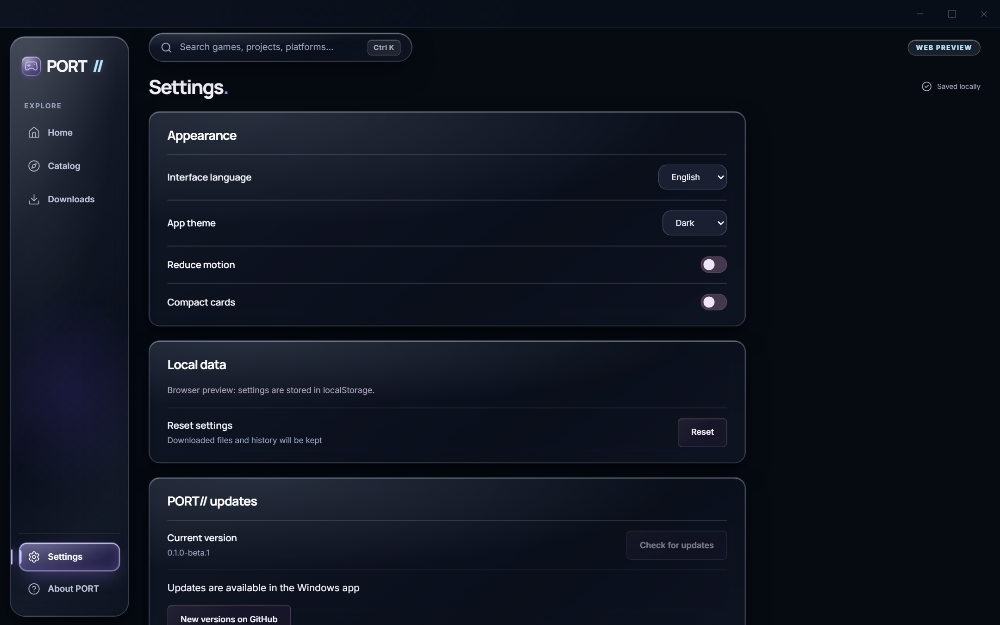

<p align="center">
  
</p>
<h1 align="center">PORT</h1>
<p align="center"><b>Native PC ports, static recompilations and decompilations. One beautiful Windows catalog.</b></p>
<p align="center">
  <a href="https://github.com/gouthwut/PORT/releases/tag/v0.1.0-beta.1"></a>
  
  <a href="LICENSE"></a>
  
</p>

---

## ⚡ Download PORT Beta 1

Get the latest installer for Windows 10 and 11 (x64):

👉 [**Download PORT-Setup-0.1.0-beta.1.exe**](https://github.com/gouthwut/PORT/releases/download/v0.1.0-beta.1/PORT-Setup-0.1.0-beta.1.exe)

| Asset        | Details                                                            |
| :----------- | :----------------------------------------------------------------- |
| **File**     | `PORT-Setup-0.1.0-beta.1.exe`                                      |
| **Version**  | `0.1.0-beta.1` (Pre-release)                                       |
| **Platform** | Windows 10 / 11 (x64)                                              |
| **SHA-256**  | `145057756bf654dc753766ab597f433c057f4ae8e3c1f9f8efb006ab5d87e94e` |

_Release assets and checksum verification are available on the [GitHub Releases page](https://github.com/gouthwut/PORT/releases/tag/v0.1.0-beta.1)._

---

## What is PORT?

**PORT** is an open-source Windows catalog and download manager designed specifically for independently developed PC ports, static recompilations, decompilations, and community runtimes.

Instead of searching forums and repositories, PORT gives you a single place to:

1. **Discover** independent PC ports and recompilations.
2. **Read** project details, hardware requirements, and the developer's manual setup instructions.
3. **Download** verified, official Windows release files directly inside the application.
4. **Open** the downloaded archive and follow the developer's step-by-step setup guide.

> **Important:** PORT **does not** automatically install, modify, or launch games. It does not contain or distribute proprietary game assets, ROMs, ISOs, or PKGs. Users provide any required game data files from their own legally owned physical or digital copies.

---

## Features

- **Live Cloud Catalog:** Projects and updates appear in the app dynamically via the secure Cloudflare API v2 without requiring an app reinstall.
- **Official Releases Only:** Downloads are fetched directly from the upstream project's official GitHub Releases.
- **Integrated Download Manager:** Track download progress, transfer speed, pause/resume, cancellation, retry, and view full download history.
- **Integrity Verification:** Automated SHA-256 checksum validation when provided by upstream release records.
- **Safety First:** Strict destination picker, overwrite protection, and no automated background binary execution.
- **Liquid Glass UI:** Modern dark design inspired by Premiere Compact aesthetics with smooth motion, keyboard navigation, and reduced-motion accessibility.
- **Multilingual Support:** English (default), Russian, Spanish, French, and German.
- **100% Local Privacy:** Saved projects, search preferences, and download history are stored locally in SQLite. No user account, tracking, or registration required.

---

## Screenshots

<p align="center">
  <b>Home Screen</b><br>
  
</p>

<p align="center">
  <b>Catalog & Discovery (Clean Empty State)</b><br>
  
</p>

<p align="center">
  <b>Integrated Download Manager</b><br>
  
</p>

<p align="center">
  <b>Settings & Localization</b><br>
  
</p>

---

## How It Works

```
┌────────────────┐       ┌──────────────────────┐       ┌────────────────┐
│  Online CMS    │ ────> │  Cloudflare API v2   │ ────> │    PORT App    │
│  (Management)  │       │  (Public & Cached)   │       │ (Windows UI)   │
└────────────────┘       └──────────────────────┘       └────────────────┘
                                                                │
                                                        Select Build & Download
                                                                ▼
                                                        ┌────────────────┐
                                                        │ GitHub Release │
                                                        │ (Official ZIP) │
                                                        └────────────────┘
```

1. **Browse:** Open PORT to browse available ports. If the catalog is fresh or between releases, you will see a clean state.
2. **Review:** Inspect supported platforms, system requirements, and the developer's installation instructions.
3. **Download:** Select an approved official Windows build and pick your preferred download location.
4. **Setup:** Use **Open Folder** to view the downloaded archive and follow the developer's instructions to complete setup.

---

## Catalog & Publishing

PORT is backed by a dedicated Cloudflare API v2.

- The catalog is maintained and published through the owner's web studio.
- Regular players and users **never need an account**, API keys, or GitHub login to use PORT.
- When new community ports are verified and published, they appear automatically in PORT for all users.

---

## Installation

### Prerequisites

- **Operating System:** Windows 10 or Windows 11 (64-bit).
- **Runtime:** Microsoft Edge WebView2 (pre-installed on Windows 10/11; automatically bootstrapped if missing).
- **No Developer Tools Needed:** You do _not_ need Node.js, Rust, Git, or Python to run PORT.

### Quick Setup

1. Download `PORT-Setup-0.1.0-beta.1.exe`.
2. Run the setup wizard (installs for the current Windows user; no admin rights required).
3. Launch **PORT** from your Start menu or desktop shortcut.

### Checksum Verification

You can verify the installer's integrity in PowerShell:

```powershell
Get-FileHash .\PORT-Setup-0.1.0-beta.1.exe -Algorithm SHA256
```

Verify that the hash matches:

```
145057756bf654dc753766ab597f433c057f4ae8e3c1f9f8efb006ab5d87e94e
```

---

## Languages

PORT comes with full interface translations across 5 languages:

- 🇬🇧 **English** (Default)
- 🇷🇺 **Russian**
- 🇪🇸 **Spanish**
- 🇫🇷 **French**
- 🇩🇪 **German**

You can switch languages at any time under **Settings → Interface language**.

---

## Frequently Asked Questions

#### Does PORT include or distribute any games?

**No.** PORT is an informational catalog and download utility. It indexes independently developed open-source ports, recompilations, and runtimes. No proprietary game assets, textures, code, or ROMs are hosted or distributed.

#### Do I need a GitHub account or API token?

**No.** PORT communicates anonymously with public catalog and GitHub release endpoints.

#### Does PORT install or launch the games?

**No.** PORT downloads the official archives released by the independent developers. Extraction, providing your legal game data, and running the port is done manually according to the developer's setup instructions.

#### Does clearing download history delete files on disk?

**No.** The download history tracks past operations in your local database. Clearing history leaves your downloaded files untouched.

---

## Building from Source

To build PORT from source:

1. **Requirements:**
   - [Node.js 24+](https://nodejs.org/)
   - [Rust](https://rustup.rs/) (stable MSVC toolchain)
   - Visual Studio C++ Build Tools & Windows SDK

2. **Clone & Install Dependencies:**

   ```powershell
   git clone https://github.com/gouthwut/PORT.git
   cd PORT
   npm ci
   ```

3. **Run in Development Mode:**

   ```powershell
   npm run tauri dev
   ```

4. **Build the Production Installer:**
   ```powershell
   powershell -ExecutionPolicy Bypass -File scripts/build-windows-beta.ps1
   ```

---

## Privacy & Security

- **Local Storage:** All settings, favorites, and download histories are stored locally on your PC in SQLite.
- **No Telemetry:** PORT does not track your usage, collect personal data, or phone home with user identifiers.
- **Safe Execution:** PORT never automatically executes or runs downloaded archives.
- **Vulnerability Reporting:** See [SECURITY.md](SECURITY.md) for instructions on responsible security disclosures.

---

## Credits & License

- Built with [Tauri 2](https://tauri.app/), [Rust](https://www.rust-lang.org/), [React](https://react.dev/), [Tailwind CSS](https://tailwindcss.com/), [Motion](https://motion.dev/), and [Lucide Icons](https://lucide.dev/).
- Fonts: [Inter](https://rsms.me/inter/) and [Manrope](https://gent.media/manrope) under the SIL Open Font License.
- Third-party notices and open-source licenses are compiled in [THIRD_PARTY_NOTICES.md](docs/licenses/THIRD_PARTY_NOTICES.md).

PORT is released under the **[MIT License](LICENSE)**.

---

## Disclaimer

PORT is an independent community project and is **not** affiliated with, authorized, maintained, sponsored, or endorsed by Sony Interactive Entertainment, Nintendo, Microsoft, Electronic Arts, SEGA, or any other game publisher or console manufacturer. All trademarks, service marks, and company names are the property of their respective owners.
