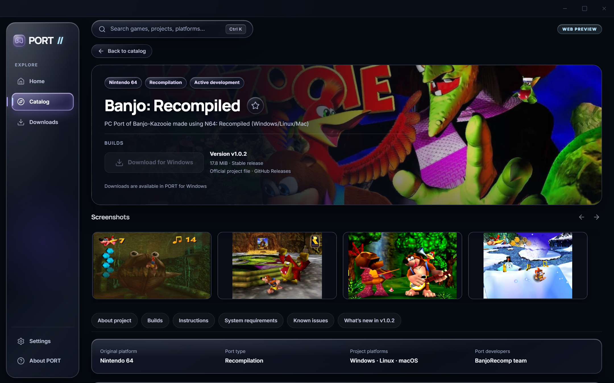

<p align="center">
  
</p>

<h1 align="center">PORT</h1>

<p align="center">
  <b>Discover native PC ports and recompilations.</b>
</p>

<p align="center">
  PORT is a free and open-source Windows application for discovering native PC ports, static recompilations, and decompilations. Browse curated projects, inspect system requirements and setup instructions, and download official developer releases directly inside the app.
</p>

<p align="center">
  <a href="https://github.com/gouthwut/PORT/releases/latest"></a>
  
  <a href="LICENSE"></a>
  
</p>

<p align="center">
  <a href="https://github.com/gouthwut/PORT/releases/latest"><b>Download for Windows</b></a>
</p>

---

## Screenshots

<p align="center">
  <b>Home — Featured Projects and New Discoveries</b><br>
  
</p>

<p align="center">
  <b>Catalog — Search, Filters, and Platform Sorting</b><br>
  
</p>

<p align="center">
  <b>Project Details — System Specifications, Compatibility, and Setup Instructions</b><br>
  
</p>

<p align="center">
  <b>Download Manager — Track Transfers and Reveal Files</b><br>
  
</p>

<p align="center">
  <b>Settings — Preferences, Theme, and Multilingual Support</b><br>
  
</p>

---

## Features

- **Discover Native Ports & Recompilations:** Explore community PC ports, recompilations, and decompilations across classic and modern console platforms.
- **Growing Dynamic Catalog:** New verified projects and releases appear automatically in the catalog without requiring manual application reinstalls.
- **Detailed Specifications:** Review screenshots, hardware requirements, engine implementation details, and compatibility status before downloading.
- **Installation Guides & Copy Steps:** Clear, step-by-step setup instructions, required asset lists, and one-click copyable steps in all five interface languages.
- **Integrated Download Manager:** Download verified, official developer releases (GitHub Releases) directly inside PORT, complete with speed tracking, pause/resume, and cancellation.
- **Download History & File Reveal:** Keep track of downloaded archives with direct one-click reveal in Windows File Explorer.
- **Automatic Catalog Updates:** Seamless catalog refresh on startup, focus, or network reconnection, with local caching for offline resilience.
- **Cryptographically Signed Updates:** Secure, built-in application updates verified with Minisign signatures.
- **Five Interface Languages:** Full localization in English, Russian, Spanish, French, and German.
- **No Account Required:** Completely free and open-source. No registration, no accounts, and no tracking.

---

## Getting Started

1. **Download and install PORT** on Windows 10 or 11.
2. **Browse the catalog** to explore projects, check system requirements, and view instructions.
3. **Download the official release** inside PORT and follow the developer's setup guide to get started.

> **Note:** PORT does not install or run games. It downloads official developer releases and provides setup instructions. Where original game files are required, you supply them from your own legally acquired game copies.

---

## Installation

### Requirements

- **Operating System:** Windows 10 or Windows 11 (64-bit).
- **Runtime:** Microsoft Edge WebView2 (included by default in modern Windows 10/11; bootstrapped automatically if absent).
- **Game Files:** Original game data files must be provided by the user where required by upstream project instructions. PORT does not host, bundle, or distribute copyrighted game data.

### Download

Download the latest installer from the official release page:

👉 [**Latest Windows Release (v0.1.0-beta.3)**](https://github.com/gouthwut/PORT/releases/latest)

| Asset        | Details                                                            |
| :----------- | :----------------------------------------------------------------- |
| **File**     | `PORT-Setup-0.1.0-beta.3.exe`                                      |
| **Version**  | `0.1.0-beta.3`                                                     |
| **Platform** | Windows 10 / 11 (x64)                                              |
| **SHA-256**  | `deddd70c5550c1116b69e424cdd305ac8681aa5f6c7f61e4841b8c14ede03732` |

---

## Languages

PORT supports five languages:

- 🇬🇧 English (Default)
- 🇷🇺 Russian
- 🇪🇸 Spanish
- 🇫🇷 French
- 🇩🇪 German

Select your preferred language at any time in **Settings → Interface language**.

---

## Frequently Asked Questions

#### Does PORT include games?

**No.** PORT is an informational catalog and download manager. It does not contain, host, or distribute copyrighted game ROMs, ISOs, binaries, or game assets.

#### Do I need an account?

**No.** PORT requires no accounts, passwords, or personal credentials. It communicates with public catalog endpoints and official release delivery hosts.

#### Does PORT install games?

**No.** PORT downloads official release packages produced by open-source port developers. Follow the step-by-step instructions displayed on the project's detail page to complete setup on your PC.

#### How do updates work?

PORT checks for application updates against the official GitHub Releases channel over HTTPS. Update packages are cryptographically verified using Minisign signatures before being applied, and installation always requires your confirmation.

#### Where do downloaded files go?

Downloaded archives are saved to the folder you choose on your computer. You can open the containing folder at any time using the **Open Folder** button in the Download Manager.

#### Is PORT free?

**Yes.** PORT is 100% free and open-source software distributed under the permissive [MIT License](LICENSE).

---

## Building from Source

### Prerequisites

- [Node.js](https://nodejs.org/) (version 22 or newer)
- [Rust](https://rustup.rs/) (stable MSVC toolchain)
- Microsoft Visual Studio C++ Build Tools & Windows SDK

### Build Instructions

```powershell
# Clone the repository
git clone https://github.com/gouthwut/PORT.git
cd PORT

# Install dependencies
npm ci

# Build the frontend
npm run build

# Run the development server
npm run tauri dev

# Run automated tests
npm test
cargo test --manifest-path src-tauri/Cargo.toml
```

---

## Privacy

PORT is built with local privacy as a core principle:

- All preferences, saved projects, and download records are stored strictly on your local PC in SQLite.
- The current published version contains no advertising trackers or mandatory telemetry.
- Optional anonymous usage statistics are strictly opt-in and off by default.

For details, see our [Privacy Policy](docs/PRIVACY.md).

---

## License & Credits

- PORT is licensed under the [MIT License](LICENSE).
- Third-party open-source components and font licenses are documented in [THIRD_PARTY_NOTICES.md](THIRD_PARTY_NOTICES.md).
- Security disclosures and vulnerability reporting: [SECURITY.md](SECURITY.md).
- Upstream port developers: All port projects are created and maintained by their respective independent community developers.

---

## Disclaimer

PORT is an independent community project and is **not affiliated with, authorized, sponsored, or endorsed by** Sony Interactive Entertainment, Microsoft Corporation, Nintendo Co., Ltd., SEGA, FromSoftware, or any other game publisher or console manufacturer. All trademarks, service marks, logos, and company names are the property of their respective copyright owners.
