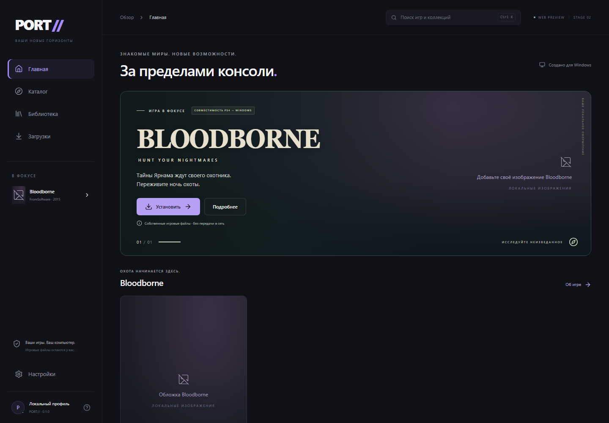

# PORT//

**Знакомые миры. Новый дом.** Независимый Windows-лаунчер консольных Windows-проектов.

Tauri 2 · React · TypeScript · Rust · SQLite



## Текущий статус

**Stage 05C: настоящий онлайн-каталог подключён автоматически.** PORT получает [опубликованный каталог](https://port-catalog-cms.port-catalog-cms.workers.dev/v1/catalog.json) при запуске, каждые пять минут, после восстановления связи и вручную. Настройка сервера и GitHub OAuth игрокам не нужны. Новые публикации приходят без пересборки exe; новый установочный адаптер требует проверенного кода клиента. Проверенные метаданные и изображения сохраняются локально, установленная библиотека независима от публикации. Ручной адрес и диагностика доступны только в developer build. Локальные fixtures включаются явно для разработки/тестов. Контракт и границы проверки: [docs/CATALOG.md](docs/CATALOG.md), [PROGRESS.md](PROGRESS.md).

Bloodborne — единственная игра со встроенным проверенным установочным адаптером. В локальную Windows-сборку заранее упакованы hero, обложка, широкий баннер и четыре исходных игровых кадра из предоставленного архива. Работают без сети и ручного импорта. Дизайн PORT сохранён; замена оформления доступна дополнительно. Права на публичное распространение материалов не подтверждены: изображения, личная сборка и новые скриншоты исключены из Git. Чистый публичный checkout собирается с пустыми слотами. См. [локальную упаковку](docs/LOCAL_ART.md).

Кнопка установки в Windows сразу открывает один стандартный диалог с множественным выбором PKG. PORT определяет основную игру и обновление по CNT + PARAM.SFO, проверяет Title/Content ID, версии и конфликты независимо от порядка файлов. Обновление необязательно. Реальные пользовательские файлы распознаны как CUSA03173 1.00 + 1.09 с одинаковым Content ID; PFS обоих помечен как зашифрованный. Проверка метаданных не доказывает полную целостность или доступность содержимого. Исходные PKG открываются только для чтения, никуда не отправляются.

Работает существующий загрузчик закреплённого Windows-архива SuperMedo `windows-v1.9.4`: реальный прогресс/скорость, пауза/Range, отмена, SHA-256 и проверка ZIP. Скачанный архив — **ещё не установленная игра**.

Установщик поддерживает собственную подготовленную папку CUSA03173 и, в сборке с [PKG worker](tools/pkg-worker/README.md), совместимый основной fake/debug PKG. Флаг шифрования сам по себе не определяет поддержку: оба предоставленных пакета прошли штатную ограниченную проверку механизма и дерева. Установка использует staging, SHA-256 манифест, проверенный Windows-runtime и SQLite-библиотеку с запуском, проверкой файлов и удалением игровых копий без удаления сохранений.

**Stage 04B: поддержан один подтверждённый update PKG CUSA03173 1.09 по полному SHA-256.** В библиотеке: «Управление игрой» → «Установить обновление». Патч проверяется отдельно, затем заменяет файлы **в текущей установке** с журналом отката при ошибке/отмене. ID, папка, сохранения и одна карточка игры сохраняются; полная копия игры/runtime не создаётся. После проверки обновляются версия и манифест. Другие патчи, произвольные дельты/retail PKG и обновление запущенной игры не поддерживаются. Первичная установка остаётся двухэтапной: основной PKG, затем действие обновления в библиотеке. Реальные нативные результаты, пользовательское подтверждение работы 1.09 и ограничения проверки gameplay — в [PROGRESS.md](PROGRESS.md).

Исторически основная игра 1.00 была установлена из предоставленного PKG и запущена через PORT до **главного меню, подтверждённого пользователем**. Затем эта же установка обновлена до 1.09; пользователь подтвердил, что она запускается и работает. Новая игровая сцена и длительная игра не проверялись в Stage 04C. Источники и результаты тестов — в документации выше.

Настройки темы, анимаций, компактности карточек и папки установки сохраняются локально в SQLite. Сам выбор папки не устанавливает игру: нужна отдельная команда установки. Проверенный кэш runtime позволяет устанавливать без повторной загрузки. Приложению не нужна сеть для просмотра каталога и изменения настроек; нет обязательной учётной записи PORT и телеметрии PORT.

## Запуск на Windows

Нужны Node.js 24 LTS, Rust stable с MSVC toolchain, Visual Studio C++ Build Tools / Windows SDK и Microsoft Edge WebView2. См. [официальные требования Tauri](https://v2.tauri.app/start/prerequisites/). Версии зависимостей закреплены lock-файлами.

```powershell
npm ci
npm run tauri dev
```

Сборка исполняемого приложения без установщика:

```powershell
npm run tauri build -- --no-bundle
.\src-tauri\target\release\port-launcher.exe
```

`npm run tauri build` дополнительно собирает NSIS-установщик. Обычные локальные сборки не имеют Windows Authenticode-подписи. Основа безопасного обновления лаунчера через подписанные Tauri-пакеты реализована; официальный публичный канал пока не подключён. Схема выпуска, ключей и изолированных испытаний — в [docs/UPDATER.md](docs/UPDATER.md). `npm run dev` — только браузерный frontend-preview, помеченный WEB PREVIEW; он использует localStorage и не заменяет Tauri.

## Проверки

```powershell
npm run build
npm run format:check
npx playwright install chromium
npm test
cargo fmt --manifest-path src-tauri/Cargo.toml -- --check
cargo test --locked --manifest-path src-tauri/Cargo.toml
cargo clippy --locked --manifest-path src-tauri/Cargo.toml -- -D warnings
```

Дополнительно: `./scripts/test-extractor.ps1` (.NET SDK 8+) проверяет отдельный writer без зависимости приложения от .NET; опциональная проверка закреплённого upstream описана в стенде. `scripts/native-continuation.mjs` проверяет настоящий release WebView через временный loopback CDP и опциональную локальную папку PKG.

Playwright проверяет навигацию, поиск/фильтры, диалоги, пустые состояния, offline, сохранение и сброс настроек, темы и размеры. Контракт multi-picker проверяется с явно указанным mock IPC; это не нативный диалог. Это frontend-тесты; проверка настоящего окна описывается отдельно в [PROGRESS.md](PROGRESS.md). [Скриншоты](screenshots/INDEX.md) разделены на браузерные и нативные.

## Архитектура

React UI → Tauri IPC → Rust → SQLite / локальные операции / закреплённый GitHub artifact. Каталог расширяемый, одна коллекция может содержать несколько названий и общий runtime; сейчас активна только Bloodborne. Настройки и локальное оформление хранятся отдельно в SQLite, browser preview использует явно обозначенный localStorage. Runtime запускается проверенным адаптером с документированным `--play`; произвольных команд/аргументов нет. PKG reader работает в отдельном ограниченном worker. Schema 4 сохраняет журнал обновления; незавершённое восстановление блокирует запуск/удаление, сохраняя файлы для отката.

```text
src/             UI, сервис настроек, доменные контракты
src-tauri/       нативное окно, SQLite, команды Rust
tests/           Playwright
screenshots/     визуальные результаты
docs/            архитектура, дизайн, исследование, страница Pages
```

Подробнее: [архитектура](docs/ARCHITECTURE.md), [дизайн](docs/DESIGN.md), [roadmap](ROADMAP.md), [contributing](CONTRIBUTING.md). Каждая новая сессия Codex сначала читает [AGENTS.md](AGENTS.md) и [PROGRESS.md](PROGRESS.md).

## Bloodborne и Windows-проект

Выбран [bloodborne_pc от SuperMedo / Mohammed Albarghouthi](https://github.com/Supermedo/bloodborne_pc), [релиз windows-v1.9.4](https://github.com/Supermedo/bloodborne_pc/releases/tag/windows-v1.9.4). Он основан на bbport/shadPS4: x86-64 код игры выполняется на CPU, графика переводится в Vulkan. Это не официальный нативный PC-релиз Bloodborne. Сравнение с Lantern Engine и лицензии — в [UPSTREAM.md](docs/UPSTREAM.md).

Runtime использует собственные **подготовленные файлы Bloodborne CUSA03173**; для community patches нужна 1.09. PORT может подготовить их из узкого поддерживаемого класса основных PKG либо импортировать готовую папку. Нужны eboot.bin, sce_module, sce_sys/param.sfo и полная dvdroot_ps4, включая shader/gxshader.shaderbnd.dcx. Версия берётся из PARAM.SFO либо остаётся неизвестной. Проверка метаданных/манифеста не доказывает подлинность дампа. Произвольные зашифрованные retail PKG, подбор passcode и обход DRM не поддерживаются.

Кнопка «Играть» использует документированный в исходниках выбранного тега `Bloodborne.exe --play` с отдельным файлом настроек установки. «Настроить runtime» открывает upstream-мастер без аргументов. Успех создания процесса не обозначается как успешная загрузка игры. Runtime, настройки и сохранения остаются на диске при удалении игровых копий из библиотеки.

Чтобы собрать личный exe с PKG worker:

```powershell
powershell -ExecutionPolicy Bypass -File scripts/fetch-pkg-source.ps1
powershell -ExecutionPolicy Bypass -File scripts/build-pkg-worker.ps1
npm run tauri build -- --no-bundle
```

Upstream source и worker остаются в игнорируемой `.local`; без worker доступен импорт папки. Самостоятельная установка .NET пользователю собранного exe не нужна.

## Roadmap

- **00 Foundation / 01 UI Prototype** — завершённая основа.
- **02 Bloodborne** — локальное оформление, multi-PKG inspector, проверенный загрузчик, ограниченный worker для поддерживаемого основного PKG.
- **03 Library / Runtime** — импорт папки/PKG, runtime, SQLite-библиотека и жизненный цикл реализованы; фактические проверки и оставшиеся ограничения — PROGRESS.md.
- **04 Distribution** — подпись, обновления, полная release-проверка.

GitHub Actions проверяет Windows-сборку; ручной workflow Pages публикует основу страницы из docs/site после настройки Pages на GitHub Actions в репозитории. Публикация страницы не выполняется автоматически.

## Лицензии и acknowledgements

Собственный код PORT — [MIT](LICENSE). [THIRD_PARTY_NOTICES.md](THIRD_PARTY_NOTICES.md) и inventories содержат сведения о зависимостях. Перед публичным распространением бинарников нужно собрать полные тексты их лицензий. Благодарим Tauri, React, Radix, Tailwind, Motion, Lucide, rusqlite/SQLite и Playwright.

Значок и исторические SVG-материалы — собственные демонстрационные материалы PORT. Официальные обложки и игровые логотипы не включены в публичный Git. Личное оформление упаковывается локально с неподтверждёнными правами на распространение; такая сборка не готова к публичной публикации. Названия игр принадлежат правообладателям; PORT не связан с Sony Interactive Entertainment или FromSoftware.
